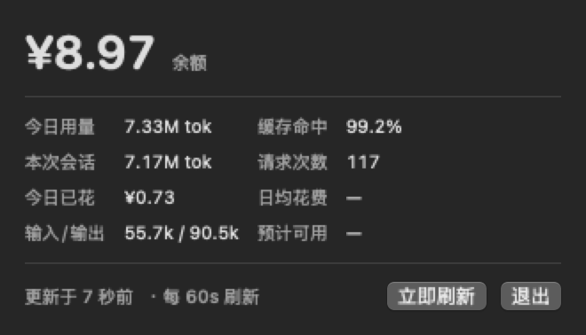

# TokenBar

macOS 菜单栏小工具：一眼看到 DeepSeek 余额和 DSH 的 token 用量。



菜单栏常驻显示 `¥8.97 · 7.33M`（余额 · 今日 token），点一下弹出上面的面板。

## 它显示什么

- **余额**：来自 DeepSeek 官方接口，低于 ¥5 转黄、低于 ¥2 转红
- **今日用量**：token 总数、请求次数、缓存命中率、输入/输出拆分
- **本次会话**：当前会话的实时消耗
- **今日已花**：用余额差值推算，**不需要价格表**，所以调价也不会算错
- **数据新鲜度**：面板底部显示「更新于 X 秒前」

## 原理

两个部分，**只通过一个 JSON 文件见面**：

```
DeepSeek 余额接口 ──┐
                    ├──►  collect.py  ──►  usage.json  ──►  TokenBar.app  ──►  菜单栏
DSH 会话日志 ───────┘      (每 60 秒)       (一个文件)       (每 5 秒读一次)
```

好处：App 不联网、不接触 API Key；采集脚本崩了界面也不会崩；任何一半都能单独替换。

细节和常见疑问（**包括「为什么登录项里会出现一个 python3」**）见
[docs/HOW-IT-WORKS.md](docs/HOW-IT-WORKS.md)。

## 环境要求

| 要求 | 说明 |
|---|---|
| macOS 14+ | 用到 SwiftUI 的 `Grid`、`NSHostingController.sizingOptions` |
| Command Line Tools | 编译 Swift 用，**不需要装 Xcode** |
| Python 3 | 采集脚本，只用标准库 |
| [zstd](https://formulae.brew.sh/formula/zstd) | 解压 DSH 会话日志，`brew install zstd` |
| [DeepSeek Harness](https://github.com/) | 提供会话日志与凭据 |

## 安装

```bash
git clone <this-repo> && cd tokenbar
brew install zstd            # 如果还没装
scripts/install.sh
```

`install.sh` 会依次：编译 → 装到 `~/Applications` → 注册每 60 秒的定时采集 → 启动。

卸载：

```bash
scripts/uninstall.sh
```

只想要数据、不要界面：

```bash
python3 src/collect.py --print
```

## 日常使用

装好之后**不需要「打开」它**——菜单栏上一直在。

| 想做什么 | 怎么做 |
|---|---|
| 看数字 | 抬头看菜单栏 |
| 看详情 | 点菜单栏图标，点面板外任意位置收起 |
| 立刻刷新 | 面板右下角「立即刷新」 |
| 退出 | 面板右下角「退出」，或 `pkill -f TokenBar` |

> 它是辅助类 App，**没有 Dock 图标也没有窗口**。双击后「看起来没反应」是正常的，去看菜单栏。
> 另外 Cmd+Q 无效（没有主菜单），退出请用面板上的按钮。

**重启电脑后**：后台采集会自动恢复（LaunchAgent 带 `RunAtLoad`），但菜单栏图标需要手动开一次：

```bash
open ~/Applications/TokenBar.app
```

## 换 App 图标

```bash
scripts/make-icon.sh ~/Desktop/某张图.webp
scripts/install.sh
```

图片**不必是正方形**，会自动裁切，位置可调：

```bash
scripts/make-icon.sh <图片> 30    # 0=贴顶，50=居中（默认），100=贴底
```

支持 png / jpg / webp / heic。

## 调整刷新频率

改 `scripts/install.sh` 顶部的 `INTERVAL`（默认 60 秒），重跑即可。

采集间隔和界面刷新是两回事：采集要联网所以保守，界面只是读本地文件所以每 5 秒一次，
看起来才接近实时。

## 目录结构

```
.
├── src/
│   ├── collect.py          # 采集：余额接口 + 会话日志 → .data/usage.json
│   ├── verify.py           # 独立重算，与 usage.json 对拍
│   └── TokenBar.swift      # 菜单栏 App
├── scripts/
│   ├── build.sh            # 编译成 dist/TokenBar.app
│   ├── install.sh          # 编译 + 安装 + 注册定时采集
│   ├── uninstall.sh        # 全部撤掉
│   └── make-icon.sh        # 任意图片 → assets/TokenBar.icns
├── docs/
│   ├── HOW-IT-WORKS.md     # 原理、常见疑问、排错
│   └── images/
└── .data/                  # 运行时数据（自动生成，已 gitignore）
```

## 数据从哪来

| 数据 | 来源 |
|---|---|
| 余额 | `https://api.deepseek.com/user/balance` |
| token 用量 | `~/.dsh/sessions/**/*.jsonl.zstd` |
| 今日已花 | `.data/history.json` 里的余额采样差值 |

API Key **不写进代码**，每次运行时从 `~/.dsh/.credentials.yaml` 现读。

## 已知限制

- `reasoningTokens` 只在旧版会话日志里有，v4 日志不再记录，所以新会话该项为 0
- 本地日志只覆盖本机 DSH 会话；其他途径直接调用 API 的消耗只能从余额变化看出来
- `今日已花` 依赖余额采样差值，首次安装后需要跑一段时间才有值

## 开发

```bash
scripts/build.sh            # 只编译
python3 src/verify.py       # 校验采集结果，退出码 0 表示一致
```

`verify.py` 会对**除当前活跃会话外**的所有日志做逐字节对拍。
活跃会话在两次运行之间会持续增长，拿它比对必然失败，所以单独排除并打印出来。

编译前请留意 `docs/HOW-IT-WORKS.md` 里记录的 Command Line Tools 打包 bug——
它会让 `import Foundation` 直接编译失败，`build.sh` 会检测并给出修法。

## License

[MIT](LICENSE)
